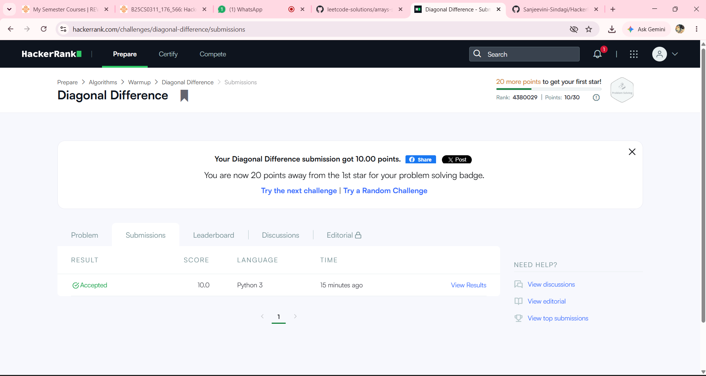
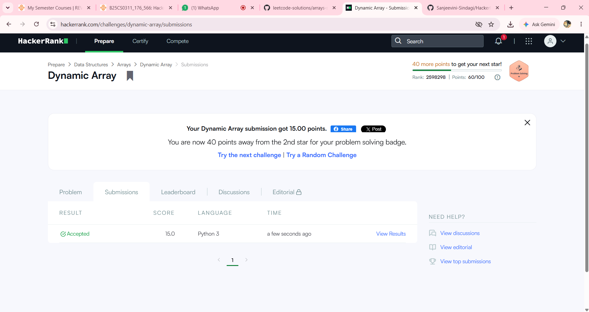
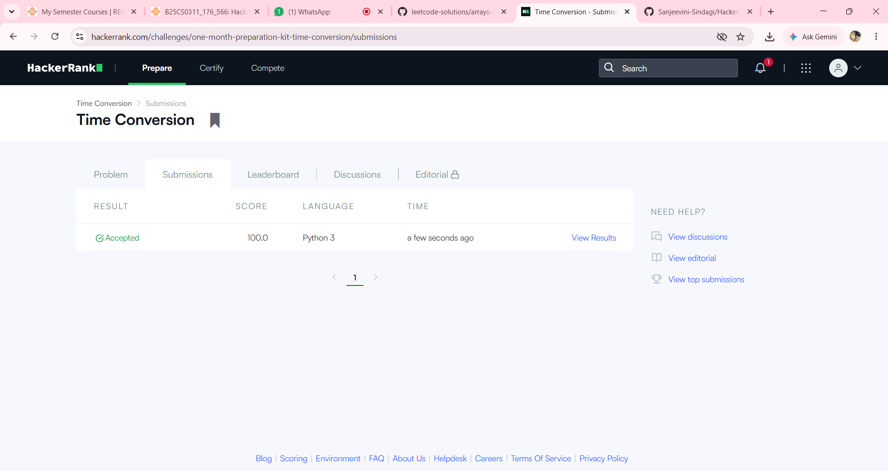
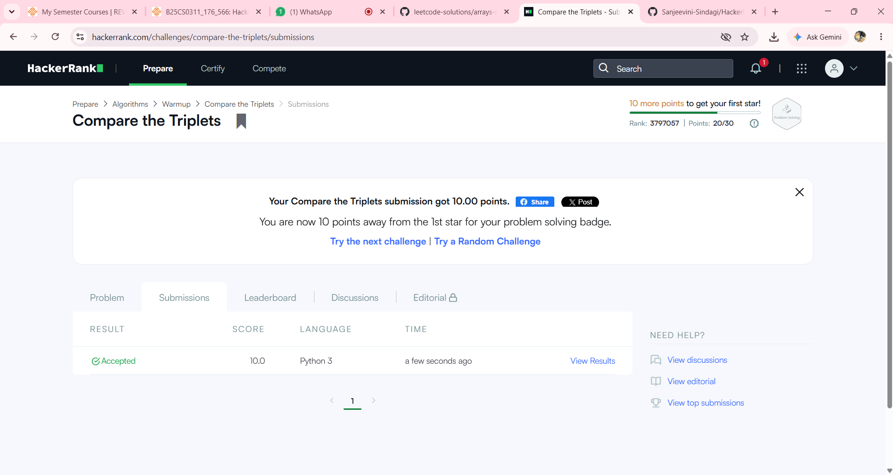
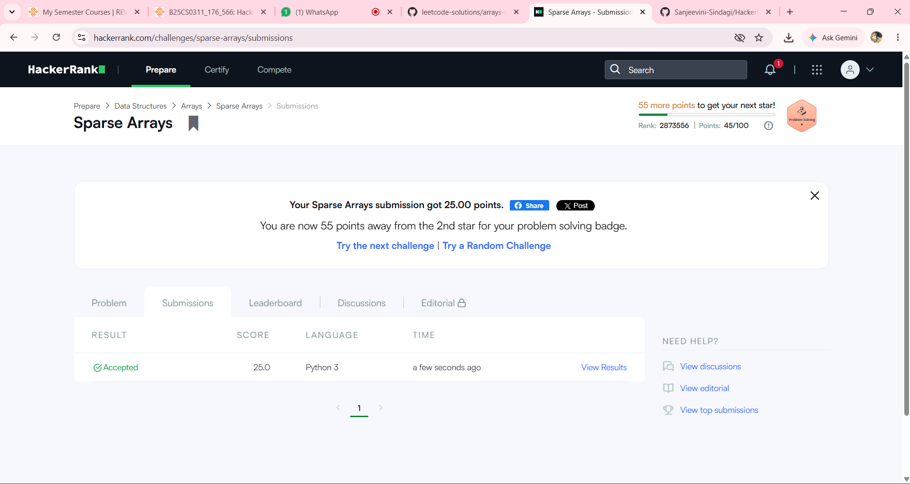

# HackerRank – 3rd Semester Portfolio

## About This Repository

This repository contains my solutions to five mandatory algorithmic problems completed as part of the Portfolio Building course in my 3rd Semester of B.Tech Computer Science and Engineering.

The problems helped me practise Python programming, data structures, array manipulation, string processing, and algorithmic optimization.

## HackerRank Profile

**Username:** sindagisanjeevi1

**Profile:** https://www.hackerrank.com/profile/sindagisanjeevi1

## Problems Solved

| No. | Problem | Concept |
|---|---|---|
| 1 | Diagonal Difference | 2D Arrays |
| 2 | Dynamic Array | Dynamic Arrays, XOR |
| 3 | Time Conversion | String Manipulation |
| 4 | Compare the Triplets | Arrays, Conditional Statements |
| 5 | Sparse Arrays | Hash Maps, Frequency Counting |

## Repository Structure

HackerRank-3rdSem-Portfolio/
├── diagonal-difference/
├── dynamic-array/
├── time-conversion/
├── compare-the-triplets/
├── sparse-arrays/
└── README.md

## Algorithm Complexity

| Problem | Time Complexity | Space Complexity |
| Diagonal Difference | O(N) | O(1) |
| Dynamic Array | O(N + Q) | O(N) |
| Time Conversion | O(1) | O(1) |
| Compare the Triplets | O(1) | O(1) |
| Sparse Arrays | O(N + Q) | O(N) |

## Submission Evidence

### 1. Diagonal Difference

### 2. Dynamic Array

### 3. Time Conversion

### 4. Compare the Triplets

### 5. Sparse Arrays

## HackerRank Badges

### Problem Solving – 3 Stars

## Learning Outcome

Through this activity, I improved my problem-solving skills, learned to optimize algorithms, practised Python programming, and gained experience using HackerRank to solve coding challenges.